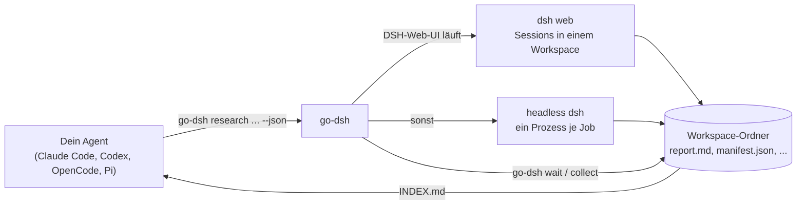

# go-dsh  /ɡoʊ ˈdæʃ/ („go dash“)

[English](README.md) | **Deutsch**

**Lass Claude Code, Codex, OpenCode, Pi oder jeden anderen Agenten [DeepSeek Harness](https://github.com/deepseek-ai/deepseek-harness) (`dsh`) parallel als Worker-Pool benutzen – als einzelnes, schnelles Rust-Binary für Windows, macOS und Linux.**

go-dsh ist eine Rust-Neuimplementierung von [dsh-cli](https://github.com/nicremo/dsh-cli) (npm-Paket, nur macOS/Linux). Kommandos, Optionen, Exit-Codes und JSON-Ausgabe folgen dem Original; dazu kommen Windows-Unterstützung und keine Node-Abhängigkeit für das Tool selbst.

> **Inoffizielles Community-Projekt.** go-dsh steht in keiner Verbindung zu DeepSeek und wird von DeepSeek weder unterstützt noch gesponsert. „DeepSeek Harness“ ist eine Marke von DeepSeek und wird hier nur zur Beschreibung der Kompatibilität genannt. Die ursprüngliche Idee und das Verhalten stammen von [Fabian Bitzer](https://github.com/nicremo) (MIT-Lizenz, siehe [Herkunft](#herkunft-und-lizenz)).

## Inhalt

- [Was go-dsh macht](#was-go-dsh-macht)
- [Funktionsweise](#funktionsweise)
- [Voraussetzungen](#voraussetzungen)
- [Installation](#installation)
- [Einrichtung (optional)](#einrichtung-optional)
- [Schnellstart](#schnellstart)
- [Befehle](#befehle)
- [Konfiguration](#konfiguration)
- [Betrieb](#betrieb)
- [Plattformhinweise (Windows, macOS, Linux)](#plattformhinweise-windows-macos-linux)
- [Fehlersuche](#fehlersuche)
- [Sicherheit](#sicherheit)
- [Entwicklung](#entwicklung)
- [Herkunft und Lizenz](#herkunft-und-lizenz)

## Was go-dsh macht

`dsh` ist ein Agenten-Harness, das mit DeepSeek-Modellen arbeitet – schnell und günstig, also ideal als Worker-Pool. Was fehlt, ist ein Weg, `dsh` von einem *anderen* (Haupt-)Agenten aus zu steuern: Sessions starten, auf sie warten, Ergebnisse lesen, nachhaken. Genau das erledigt go-dsh.

go-dsh ist **agent-first**: Jeder Befehl ist nicht-interaktiv, kehrt sofort zurück, liefert kompakten Text oder `--json` und benutzt stabile Exit-Codes.

- **Parallele Recherche-Batches** – `go-dsh research "Frage 1" "Frage 2" …` startet je Frage einen Worker; jeder schreibt `report.md` und `sources.json`, `go-dsh collect` fasst alles in einer `INDEX.md` zusammen.
- **Material sammeln** – `go-dsh materials "Briefing"` startet je Materialart einen Worker (Screenshots, Scroll-Videos, News-Artikel, Stock-Videos, Stock-Fotos) mit `manifest.json` samt Quelle und Lizenz je Datei.
- **Live in der DSH-Web-UI** – läuft `dsh web`, wird jeder Job zu einer echten Session in dieser UI; ein Batch bekommt einen eigenen Workspace, jede Session einen lesbaren Titel.
- **Headless-Fallback** – ohne UI läuft jeder Job in einem eigenen `dsh`-Prozess mit schlankem Profil (`concert`).
- **Steuern wie ein Mensch** – `wait`, `status`, `logs -f`, `result`, `files`, `continue` (gleiche Session, gleicher Ordner), `cancel`.
- **Deterministische Captures** – `go-dsh capture shot|scroll <url>` erzeugt saubere Screenshots und flüssige 1080p-Scroll-Videos mit Playwright (Cookie-Banner weg, Overlays ausgeblendet, Werbenetzwerke blockiert, Watchdog gegen hängende Seiten).
- **Kein Daemon** – der Zustand liegt als einfaches JSON in `~/.dshgo/`; abgekoppelte Runner-Prozesse halten Jobs am Leben, auch wenn die aufrufende Shell endet.
- **Agent-Skill** – ein mitgeliefertes Skill (`go-dsh-delegation`) bringt Claude Code, Codex, OpenCode und Pi bei, wann und wie sie Arbeit an DeepSeek Harness delegieren.

## Funktionsweise



1. Dein Agent ruft `go-dsh` auf (meist über das mitgelieferte Skill).
2. go-dsh legt einen Workspace-Ordner und je Aufgabe einen Job an, übergibt jeden Job an einen abgekoppelten Runner (derselbe Binary, versteckte Befehle `__run-job` / `__run-batch`) und gibt sofort die IDs zurück.
3. Der Runner erstellt entweder eine Session in der laufenden DSH-Web-UI (über deren HTTP-API) oder startet `dsh --profile concert --json -` und übergibt die Aufgabe über stdin.
4. Ereignisse landen in `~/.dshgo/jobs/<id>/events.jsonl`, der Fortschritt in `job.json`, die Endantwort in `result.md`.
5. Dein Agent wartet mit `go-dsh wait`, liest `go-dsh result` bzw. `go-dsh collect` und führt Sessions mit `go-dsh continue` fort.

## Voraussetzungen

| Komponente | Wofür | Pflicht |
|---|---|---|
| **DeepSeek Harness (`dsh`)** | führt die eigentliche Arbeit aus; einmal anmelden bzw. `DEEPSEEK_API_KEY` setzen | ja |
| Rust ≥ 1.80 | nur zum Selbstbauen | nein |
| Python 3 + Playwright | nur für `go-dsh capture` | nein |
| ffmpeg / ffprobe | Scroll-Videos und Medienprüfung | nein |
| yt-dlp | Stock-Videos laden | nein |

`dsh` wird laut Upstream mit `npm install -g @deepseek-ai/dsh` installiert (oder als Quell-Checkout verwendet). `go-dsh doctor` prüft das alles.

Unterstützte Plattformen: **Windows 10/11**, **macOS**, **Linux** (je x86-64 und ARM64, wo Rust sie unterstützt).

## Installation

go-dsh wird aus dem Quelltext gebaut (einzige Voraussetzung: [Rust](https://rustup.rs)). Die Installation erfolgt **einmal pro Rechner**, nicht pro Projekt.

```bash
git clone https://github.com/biegomar/go-dsh.git
cd go-dsh
cargo install --path .
```

Das installiert zwei Programme nach `~/.cargo/bin` (Windows: `%USERPROFILE%\.cargo\bin`), das bereits im `PATH` liegt, wenn Rust über `rustup` installiert wurde:

- `go-dsh` – der Hauptbefehl
- `dshgo` – kurzer Alias

Alternativ ein Release-Binary bauen und selbst ablegen:

```bash
cargo build --release
# Ergebnis: target/release/go-dsh(.exe) und target/release/dshgo(.exe), je ca. 3 MB, ohne Laufzeitabhängigkeiten
```

Installation prüfen:

```bash
go-dsh doctor    # prüft dsh, Profil, Einstellungen, Web-UI, Playwright, ffmpeg, yt-dlp
```

Ob du zusätzlich `go-dsh setup` brauchst, steht unter [Einrichtung (optional)](#einrichtung-optional).

### Optional: Playwright für `go-dsh capture`

```bash
pip install playwright
python -m playwright install chromium
```

Wird Python nicht automatisch gefunden: `go-dsh config set python <Pfad-zu-python>`.

## Einrichtung (optional)

go-dsh funktioniert direkt nach der Installation. `go-dsh setup` bereitet dsh nur für **Headless**-Jobs vor und installiert den Agent-Skill. Such dir aus, was du brauchst:

| Du möchtest … | Aufruf |
|---|---|
| Jobs von Hand gegen die DSH-Web-UI starten | nichts, keine Einrichtung nötig |
| einen Agenten (Claude Code, Codex, OpenCode, Pi) go-dsh aufrufen lassen | `go-dsh skill install` |
| Headless-Jobs mit Such-MCP-Servern oder ausgewählten Skills fahren | `go-dsh setup` (Optionen unten) |
| die Umgebung jederzeit prüfen | `go-dsh doctor` |

> **Hinweis:** Jobs, die in der DSH-Web-UI laufen, führt der dsh-Server der UI mit *seinem* Profil, seinen MCP-Servern und Skills aus. Das von `setup` angelegte Profil `concert` gilt nur für **Headless**-Jobs (keine UI aktiv oder `-b headless`).

### Was `go-dsh setup` tut

1. Legt das dsh-Profil `concert` in `~/.dsh/profiles/concert/` an (aus dem Headless-Template von dsh).
2. Kopiert Such-/Recherche-MCP-Server aus einem anderen dsh-Profil hinein (Standard: aus `web`; geschrieben nach `cordis.patch.yml`, nur für dich lesbar, soweit die Plattform das kann; es wird nichts ausgegeben, weil Zeilen API-Schlüssel enthalten können).
3. Verknüpft die Skills, die **du nennst**, nach `~/.dsh/skills-concert/`, das das Profil an dsh weitergibt (Standard: keine).
4. Installiert den Agent-Skill `go-dsh-delegation` nach `~/.agents/skills/` und verknüpft oder kopiert ihn in die Konfigurationsordner von Claude Code, Codex und Pi, soweit installiert.
5. Prüft das Ergebnis mit `dsh --profile concert --dump-config`.

Du kannst es gefahrlos erneut ausführen: Es überschreibt nur Dateien, die es selbst verwaltet (die `cordis.patch.yml` des Profils, die Verknüpfungen in `skills-concert`, die Skill-Ordner).

### Optionen

| Option | Bedeutung | Standard |
|---|---|---|
| `--mcp research\|all\|none\|id,id` | welche MCP-Server kopiert werden; `research` trifft firecrawl, brave, context7, exa, tavily, perplexity, jina, serper, searx, kagi; eine Komma-Liste trifft Zeilen-IDs oder Servernamen | `research` |
| `--from <Profil>` | dsh-Profil, aus dem die MCP-Server kopiert werden | `web` |
| `--skills a,b,c\|all` | Skills, die aus `~/.agents/skills` verknüpft werden; `all` behält die dsh-eigenen Skill-Standards | keine |
| `--no-skill` | Agent-Skill nicht installieren | Skill wird installiert |

### Beispiele

```bash
# 1. Standard: Recherche-MCP-Server aus dem Profil "web", keine Skills, Agent-Skill installieren
go-dsh setup

# 2. Nur das Profil, den Agent-Skill in Ruhe lassen
go-dsh setup --no-skill

# 3. Alle MCP-Server von "web" kopieren, gar keine, oder genau diese (Zeilen-ID oder Servername)
go-dsh setup --mcp all
go-dsh setup --mcp none
go-dsh setup --mcp firecrawl,brave

# 4. MCP-Server aus einem anderen dsh-Profil übernehmen
go-dsh setup --from work

# 5. Headless-Workern zwei Skills mitgeben (sie müssen in ~/.agents/skills existieren)
go-dsh setup --skills playwright,firecrawl

# 6. Die Skill-Standards von dsh behalten
go-dsh setup --skills all

# 7. Kombiniert
go-dsh setup --mcp context7,exa --skills playwright --no-skill

# Nur den Agent-Skill, ohne dsh anzufassen (Kopie statt Verknüpfung)
go-dsh skill install
go-dsh skill install --agents claude,codex --copy
```

So findest du heraus, welche Namen du verwenden kannst (PowerShell unter Windows; anderswo leisten `ls` und `grep serverName` dasselbe):

```powershell
dir $HOME\.agents\skills                                         # verfügbare Skills für --skills
Select-String serverName $HOME\.dsh\profiles\web\cordis.patch.yml   # MCP-Server des Profils "web"
```

Beispielausgabe (deine Namen und Zahlen weichen ab):

```
dsh profile "concert" ready: C:\Users\you\.dsh\profiles\concert
  MCP servers: firecrawl, brave
  Skills:      2 linked in C:\Users\you\.dsh\skills-concert
Agent skill installed: C:\Users\you\.agents\skills\go-dsh-delegation
  claude   linked
  codex    skipped (not installed)
  pi       skipped (not installed)
DSH web UI found at http://127.0.0.1:3080: jobs will run there.
```

Zeilen mit `Note:` sind Hinweise, keine Fehler, zum Beispiel „no skills selected“ oder „no matching MCP servers in the "web" profile; workers use the built-in web_search and web_fetch“. Unter Windows ohne Entwicklermodus wird der Agent-Skill `copied` statt `linked`.

Danach zeigt `go-dsh doctor` eine Zeile `✓ profile` mit dem Ordner von `concert`, und Headless-Jobs starten mit `dsh --profile concert`.

### Rückgängig machen

Lösche, was `setup` angelegt hat; `go-dsh doctor` fällt dann auf das eingebaute dsh-Profil `headless` zurück.

```powershell
Remove-Item -Recurse $HOME\.dsh\profiles\concert, $HOME\.dsh\skills-concert
Remove-Item -Recurse $HOME\.agents\skills\go-dsh-delegation
Remove-Item -Recurse $HOME\.claude\skills\go-dsh-delegation, $HOME\.codex\skills\go-dsh-delegation   # falls vorhanden
```

```bash
rm -rf ~/.dsh/profiles/concert ~/.dsh/skills-concert ~/.agents/skills/go-dsh-delegation
rm -rf ~/.claude/skills/go-dsh-delegation ~/.codex/skills/go-dsh-delegation                         # falls vorhanden
```

## Schnellstart

Drei Recherche-Fragen parallel bearbeiten lassen und die Ergebnisse einsammeln:

```bash
go-dsh ui start                       # optional: DSH-Web-UI starten, um die Jobs live zu sehen
go-dsh research "Welche Async-Runtimes gibt es in Rust und wann passt welche?" \
                "Vergleich von SQLite-Bibliotheken für Rust" \
                "Stand des WebAssembly Component Model" \
                --depth standard -C ~/dsh-workspaces/rust-recherche
go-dsh wait last-batch --timeout 9m   # Exit-Code 4: läuft noch, einfach erneut warten
go-dsh collect last-batch             # schreibt ~/dsh-workspaces/rust-recherche/INDEX.md
```

Einzelaufgaben, Material, Nachfragen und Captures:

```bash
go-dsh run -w "Nenne die wichtigsten Neuerungen der Rust-Edition 2024 in fünf Stichpunkten"
go-dsh materials "Balkonkraftwerke in Deutschland, sachlicher Ton" --kinds screenshots,articles
go-dsh continue last "Ergänze eine Tabelle mit Vor- und Nachteilen"
go-dsh capture shot https://www.rust-lang.org -o rust.png --full
```

Unter Windows (PowerShell) mit einer Aufgabenliste aus einer Datei (eine Aufgabe pro Zeile, `#` leitet einen Kommentar ein):

```powershell
@"
# Aufgaben für heute
Fasse die Neuerungen der letzten drei Rust-Releases zusammen
Liste gängige Fehlerquellen beim Cross-Compiling unter Windows auf
"@ | Set-Content aufgaben.txt -Encoding utf8

go-dsh batch -f aufgaben.txt -C D:\dsh-workspaces\rust-tipps -p 2
go-dsh wait last-batch --timeout 9m
go-dsh collect last-batch
```

### Aus dem eigenen Agenten benutzen

Nach `go-dsh setup` bzw. `go-dsh skill install` kennen deine Agenten das Skill. Frag einfach in natürlicher Sprache:

> Lass DeepSeek Harness parallel prüfen, welche der fünf Bibliotheken in `Cargo.toml` veraltet sind, und fasse mir das Ergebnis zusammen.

Das Skill weist den Agenten an, einen Batch zu starten, in Schritten zu warten, die zu seinem Shell-Timeout passen, `INDEX.md` zu lesen, Stichproben zu prüfen und bei Bedarf nachzuhaken. `go-dsh guide` gibt dasselbe Handbuch für Agenten ohne Skill-Unterstützung aus.

## Befehle

| Befehl | Wirkung |
|---|---|
| `go-dsh run <Aufgabe>` | ein Job im Hintergrund (`-w` wartet und gibt die Antwort aus) |
| `go-dsh batch -f aufgaben.txt` | viele Jobs parallel, je ein Ordner (`.txt`, Blöcke getrennt durch `---`, `.json`, `.jsonl`) |
| `go-dsh research <Frage>...` | parallele Recherche-Worker (`--depth quick\|standard\|deep`, `--focus`) |
| `go-dsh materials <Briefing>` | ein Worker je Materialart (`--kinds`, `--count`, `--url`) |
| `go-dsh status [ref]` | Überblick bzw. Details zu Job oder Batch |
| `go-dsh ls [--batches]` | Jobs oder Batches auflisten (`-n`, `--running`, `--batch`) |
| `go-dsh wait <ref>...` | blockiert bis fertig (`--timeout`, `--any`) |
| `go-dsh result <ref>` | Endantwort(en) (`--files`) |
| `go-dsh logs <job>` | Zeitleiste der Tool-Aufrufe (`-f`, `--full`, `--raw`, `--stderr`) |
| `go-dsh files <ref>` | vom Job erzeugte Dateien (`--all`) |
| `go-dsh continue <job\|batch> <Text>` | dieselbe Session fortsetzen; bei einem Batch bekommt jeder beendete Job den Folgetext, als neuer Batch (`--only-failed`, `-p`) |
| `go-dsh cancel <ref>` | Job oder ganzen Batch stoppen |
| `go-dsh collect <batch>` | `INDEX.md` schreiben, `manifest.json` und `sources.json` zusammenführen (`-o`) |
| `go-dsh capture shot\|scroll <url>` | Screenshots und Scroll-Videos |
| `go-dsh ws init <Ordner>` | Workspace mit Konventionen in `AGENTS.md` anlegen |
| `go-dsh ui [start\|stop\|login]` | DSH-Web-UI öffnen, starten (`--open` öffnet auch den Browser), beenden bzw. anmelden |
| `go-dsh skill install` | Agent-Skill installieren oder aktualisieren |
| `go-dsh setup` / `go-dsh doctor` | Ersteinrichtung / Umgebungsprüfung |
| `go-dsh config [set\|unset]` | persistente Einstellungen |
| `go-dsh guide` | das Handbuch für Agenten |

**Referenzen** (`<ref>`): Job-ID, Batch-ID, eindeutiges Präfix, Name, `last` (neuester Job), `last-batch` (neuester Batch).

**Gemeinsame Optionen:** `-C <Ordner>` Workspace-Ordner · `-m flash|pro|v4-flash|vision` (oder volle Modell-ID) · `--effort off|low|high|max` · `-t <Dauer>` Zeitlimit (`90s`, `20m`, `1h`; Standard 30m) · `-p <n>` Parallelität · `-b auto|web|headless` Backend · `-w` warten · `--max-wait <Dauer>`. Jeder Befehl kennt `--help`.

### JSON-Ausgabe und Exit-Codes

Jeder Befehl akzeptiert `--json` und gibt genau ein Objekt aus: `{ "ok": true, … }` oder `{ "ok": false, "error", "code", "hint" }`.

| Exit-Code | Bedeutung |
|---|---|
| 0 | Erfolg |
| 1 | ein Job ist fehlgeschlagen, hat das Zeitlimit überschritten oder wurde abgebrochen |
| 2 | Aufruffehler |
| 3 | Job oder Batch nicht gefunden |
| 4 | Warte-Timeout erreicht oder Job noch nicht fertig |
| 5 | Umgebungsproblem (dsh fehlt, UI nicht erreichbar, Playwright fehlt) |

## Konfiguration

`go-dsh config set <Schlüssel> <Wert>` speichert in `~/.dshgo/config.json` (Windows: `%USERPROFILE%\.dshgo\config.json`). **Umgebungsvariablen haben Vorrang vor der Datei.** `go-dsh config` zeigt die wirksamen Werte samt Herkunft.

| Schlüssel | Umgebungsvariable | Bedeutung |
|---|---|---|
| `dshRepo` | `DSHGO_DSH_REPO` | dsh-Quell-Checkout verwenden (hat Vorrang vor `dshBin`) |
| `dshBin` | `DSHGO_DSH_BIN` | Pfad zur `dsh`-Programmdatei (Standard: `dsh` im `PATH`; unter Windows wird auch `dsh.cmd` gefunden) |
| `webUrl` | `DSHGO_WEB_URL` | Origin der DSH-Web-UI (Standard `http://127.0.0.1:3080`) |
| `backend` | `DSHGO_BACKEND` | `auto`, `web` oder `headless` |
| `workspaces` | `DSHGO_WORKSPACES` | Wurzel für neue Workspaces (Standard `~/dsh-workspaces`) |
| `python` | `DSHGO_PYTHON` | Python mit Playwright für Captures |

Weitere Variablen:

| Variable | Bedeutung |
|---|---|
| `DSHGO_HOME` | Zustandsordner (Standard `~/.dshgo`) |
| `DSH_HOME` | dsh-Home (Standard `~/.dsh`) |
| `DSH_AGENTS_HOME` | Wurzel der gemeinsamen Skills (Standard `~/.agents`) |
| `DSHGO_WEB_TOKEN_URL` / `DSHGO_WEB_TOKEN_FILE` | Token-URL der Web-UI |
| `DSHGO_WEB_POLL_MS` | Abfrageintervall des Web-Backends in ms (Standard 2000) |
| `DSHGO_DSH_CMD` | Ersatz-Programm für `dsh` (Tests) |
| `CLAUDE_CONFIG_DIR`, `CODEX_HOME` | abweichende Konfigurationsordner für die Skill-Installation |

`~` wird in Einstellungen und Pfadargumenten erweitert (unter Windows auch `~\`).

### Dateien

```
~/.dshgo/
  config.json            Einstellungen
  web-auth.json          Cookie für die DSH-Web-UI (unter Linux/macOS Modus 0600)
  web-token-url          zuletzt gemerkte Token-URL
  capture.py             eingebettetes Capture-Skript (wird bei Bedarf geschrieben)
  jobs/<id>/             job.json, task.md, events.jsonl, stderr.log, result.md
  batches/<id>/          batch.json
  logs/                  Runner-Logs
<workspace>/
  AGENTS.md, .dshgo-workspace
  <nn-job>/              ein Ordner je Batch-Job
  INDEX.md               nach go-dsh collect
```

Zustandsordner, Variablen (`DSHGO_*`) und Workspace-Marker (`.dshgo-workspace`) sind bewusst eigenständig benannt und kollidieren nicht mit dsh-cli (`~/.dsho`, `DSHO_*`). Beide Tools können parallel installiert sein, teilen aber keinen Zustand.

## Betrieb

### Das Web-UI-Backend

Ist die DSH-Web-UI erreichbar, spricht go-dsh deren HTTP-API an (`POST /api/<namespace>/<method>`): Es registriert den Workspace-Ordner, erstellt darin eine Session, benennt sie, wählt optional ein Modell, sendet die Aufgabe und fragt das Session-Log ab, bis der Turn, der die Aufgabe beantwortet, beendet ist. Das Session-Log wird in dasselbe Ereignisformat übersetzt wie im Headless-Betrieb, sodass `logs`, `status` und `result` überall gleich funktionieren.

- `go-dsh ui start` startet `dsh web` im Hintergrund, liest die ausgegebene Token-URL mit und meldet sich an. Einen Browser öffnet es nicht; dafür gibt es `--open` (`go-dsh ui start --open`, auch wenn die UI schon läuft) oder jederzeit `go-dsh ui`. Beide öffnen die gemerkte Token-URL, sodass auch der Browser angemeldet ist; `go-dsh ui --print` gibt nur die einfache Adresse aus.
- `go-dsh ui stop` beendet die lokale DSH-Web-UI (den `node`-Prozess hinter Port 3080 samt Kindprozessen). Es greift nur bei einem Port, der wirklich als Web-UI antwortet, und verweigert, solange noch Web-Jobs laufen (`--force` beendet trotzdem; diese Jobs gehen verloren). Warte vorher mit `go-dsh wait` bzw. brich mit `go-dsh cancel` ab, oder nimm `go-dsh ui stop --force`. Auch eine von Hand im Terminal gestartete UI lässt sich so beenden.
- Startest du `dsh web` selbst, übergib einmalig die ausgegebene URL: `go-dsh ui login "http://127.0.0.1:3080/?token=..."`. Das Cookie liegt in `~/.dshgo/web-auth.json`, ist 30 Tage gültig und übersteht Server-Neustarts.
- `-b web` macht eine fehlende UI zum Fehler, statt still auf Headless zurückzufallen. `go-dsh ui <ref>` nennt Workspace und Session-Titel, nach denen du in der UI suchen musst.

### Das Headless-Backend und `go-dsh setup`

Headless-Jobs führen `dsh --profile concert --json -` im Job-Ordner aus. `go-dsh setup` baut dieses Profil aus dem mitgelieferten Headless-Template plus:

- **MCP-Server**, die aus einem anderen Profil kopiert werden (Standard `web`): `--mcp research` (firecrawl, Brave, context7, Exa, Tavily, Perplexity, Jina u. ä.; Standard), `all`, `none` oder eine Komma-Liste von IDs. Kopierte Zeilen können API-Schlüssel enthalten – die Profildatei wird daher (wo möglich) nur für den Benutzer lesbar geschrieben, und nichts davon wird ausgegeben. `!!js`-Ausdrücke bleiben beim Kopieren unverändert erhalten.
- **Skills, die du mit `--skills a,b,c` nennst**: Sie werden aus `~/.agents/skills` nach `~/.dsh/skills-concert` verknüpft, den das Profil `concert` an dsh weitergibt. Standardmäßig werden **keine Skills** verknüpft, das hält den Worker-Prompt so klein wie möglich. Ein Name, den es in `~/.agents/skills` nicht gibt, wird gemeldet und übersprungen; Verknüpfungen eines früheren Laufs, die nicht mehr genannt werden, entfernt go-dsh. `--skills all` behält stattdessen die dsh-Standards.
- `.dshgo-workspace` als zusätzliche Projektwurzel-Markierung, damit Worker in Batch-Unterordnern die `AGENTS.md` des Workspaces laden.

### Jobs, Batches und Abbruch

- Start ist asynchron: `run`, `batch`, `research` und `materials` geben sofort IDs zurück (mit `-w` blockieren sie bis zum Ergebnis).
- `wait --timeout 9m` bleibt unter dem 10-Minuten-Limit eines einzelnen Shell-Aufrufs in den meisten Agenten; Exit-Code 4 heißt „läuft noch, erneut warten“.
- `continue` akzeptiert auch einen Batch: Jeder Job, der nicht mehr läuft und eine Session hat, bekommt denselben Folgetext und arbeitet in seiner eigenen Session und seinem eigenen Ordner weiter. Die Fortsetzungen bilden einen **neuen Batch** (die Jobs verweisen auf ihre Originale), sodass `wait`, `status` und `collect` wie gewohnt funktionieren. `--only-failed` überspringt Jobs, die schon `done` sind; noch laufende Jobs werden übersprungen und aufgelistet.
- Ein Job, dessen Runner-Prozess verschwunden ist (Neustart, Kill), wird als `lost` gemeldet – einfach neu starten.
- `cancel` schreibt eine Abbruch-Markierung und beendet den `dsh`-Prozess; ein Batch-Abbruch erfasst alle unfertigen Jobs. Beim Web-Backend wird `session/cancel` an die UI gesendet.
- Parallelität eines Batches begrenzt `-p` (Standard: alle, höchstens 10); die erste Welle startet leicht gestaffelt (400 ms), damit parallele `dsh`-Starts nicht um Caches konkurrieren.

### Captures

`go-dsh capture shot|scroll <url> -o <Datei>` startet das eingebettete Python/Playwright-Skript (Chromium von Playwright, nie das installierte Chrome). Voreinstellung: Cookie-Banner wegklicken, Overlays ausblenden, Werbenetzwerke blockieren, WebGL aus. Weitere Schalter: `--no-dismiss`, `--keep-overlays`, `--allow-ads`, `--hide <css>`, `--dark`, `--scale 2` (shot), `--max-time <s>` (harte Zeitgrenze). Scroll-Videos benötigen ffmpeg. Die Ausgabe ist ein JSON-Objekt.

## Plattformhinweise (Windows, macOS, Linux)

go-dsh verhält sich auf allen Plattformen gleich; folgende Punkte sind Windows-spezifisch umgesetzt:

- **Abgekoppelte Runner**: Auf Windows startet go-dsh Runner ohne Konsolenfenster in einer eigenen Prozessgruppe und gibt seine eigenen Standard-Handles nicht an den Runner weiter. Dadurch kehrt ein aufrufender Agent, der stdout abgreift, sofort zurück statt erst nach Ende des Jobs.
- **Abbruch**: Windows kennt kein „sanftes“ SIGTERM für Konsolenprozesse. `cancel` und Zeitüberschreitungen beenden den `dsh`-Prozessbaum mit `taskkill /T /F`; unter macOS/Linux erhält die Prozessgruppe zuerst SIGTERM und nach 5 s SIGKILL.
- **`dsh.cmd`**: Per npm installierte Programme sind unter Windows `.cmd`-Dateien. go-dsh findet sie über `PATH`/`PATHEXT`.
- **Skills verknüpfen**: Symlinks erfordern unter Windows den Entwicklermodus oder Administratorrechte. Sind sie nicht erlaubt, kopiert go-dsh den Skill-Ordner stattdessen (Ausgabe: `copied` statt `linked`; `go-dsh skill install` aktualisiert Kopien später wieder).
- **Dateirechte**: Der Modus 0600 für Cookie/Token/Profil gilt nur unter Linux/macOS; unter Windows schützt das Benutzerprofil die Dateien.
- **Python**: Als Kandidaten für Captures werden `python`, `python3` und `py` geprüft (der Microsoft-Store-Platzhalter wird übersprungen, weil er `playwright` nicht importieren kann).
- **Web-UI nur über HTTP**: go-dsh baut ohne TLS-Bibliothek; die lokale DSH-Web-UI läuft auf `http://127.0.0.1`. Eine `https://`-`webUrl` wird nicht unterstützt.

## Fehlersuche

| Symptom | Lösung |
|---|---|
| `dsh not found` | `npm install -g @deepseek-ai/dsh`, oder `go-dsh config set dshBin <Pfad>` bzw. `dshRepo <Pfad>` |
| Jobs erscheinen nicht in der UI | `go-dsh doctor`; `go-dsh ui start` oder `go-dsh ui login <url>`; Jobs mit `-b web` starten |
| Ein Job ist `lost` | sein Runner-Prozess ist gestorben (Neustart, Kill); erneut starten |
| Ein Headless-Job ist `failed` mit `MISSING_CREDENTIAL` (`no API key for provider route "deepseek-official"`) | Headless-Jobs brauchen einen API-Schlüssel: `DEEPSEEK_API_KEY` exportieren oder auf der Models-Seite der DSH-Web-UI hinterlegen. Jobs in der Web-UI brauchen ihn nicht; `go-dsh doctor` zeigt die Zeile `api-key` |
| Headless-Worker bleiben hängen | in dsh das Permission-Preset auf vollen Zugriff stellen (`go-dsh doctor` zeigt es an) |
| `go-dsh capture` schlägt fehl | `pip install playwright && python -m playwright install chromium`; Scroll-Videos brauchen ffmpeg |
| Eine Seite hängt beim Capture | der Watchdog beendet sie nach `--max-time` (Standard 90 s bei Screenshots) |
| `Cannot authenticate against the DSH web UI` | `go-dsh ui login "<URL mit ?token=…>"` mit der Ausgabe von `dsh web` |
| Mehr Details zu einem Fehler | `go-dsh logs <job> --stderr` bzw. `go-dsh status <job>` |

## Sicherheit

`dsh`-Worker können Shell-Befehle ausführen; viele Setups laufen mit vollem Zugriff und ohne Sandbox. Halte Aufgaben auf den Workspace begrenzt und delegiere niemals Löschvorgänge, Deployments, `git push` oder alles, was Geheimnisse berührt. Von Workern gefundenes Material darfst du nicht automatisch veröffentlichen: prüfe Lizenz und Quelle in `manifest.json`. Die Cookie-/Token-Dateien in `~/.dshgo` sind vertraulich.

## Entwicklung

```bash
cargo build                 # Debug-Build
cargo test                  # Unit-Tests + Integrationstests
cargo clippy --all-targets
cargo fmt
```

Die Integrationstests starten das echte `go-dsh`-Binary gegen ein Fake-`dsh` (`examples/fake_dsh.rs`) und gegen eine kleine Fake-Web-UI (`tests/web.rs`); sie berühren nie dein echtes Setup. Das Fake-`dsh` versteht in der Aufgabe die Marker `SLEEP <s>`, `WRITE <datei>` und `FAIL`.

Aufbau (`src/`):

| Datei | Aufgabe |
|---|---|
| `cli.rs` | Befehlszeile (clap), Befehle, Text-/JSON-Ausgabe |
| `runner.rs` / `supervisor.rs` | Ausführung eines Jobs bzw. eines Batches, Abbruch, abgekoppelte Prozesse |
| `store.rs` | Jobs und Batches als JSON, Referenzauflösung, `lost`-Erkennung |
| `dsh.rs` | `dsh` finden und starten (Binary, Quell-Checkout, Ersatzprogramm) |
| `web.rs` | Client der DSH-Web-UI (Auth, Sessions, Ereignisübersetzung, `ui start`) |
| `events.rs` | Ereignisstrom → Fortschritt und Zeitleiste |
| `collect.rs` | `INDEX.md`, `manifest.json`, `sources.json` |
| `templates.rs` | Prompt-Vorlagen für Worker und `AGENTS.md` |
| `profile.rs` | `setup` (Profil `concert`) und `doctor` |
| `skills.rs` | Agent-Skill installieren |
| `config.rs`, `paths.rs`, `util.rs` | Einstellungen, Pfade, Hilfsfunktionen und plattformspezifische Prozessfunktionen |
| `assets/` | eingebettet: `guide.md`, Skill, `capture.py` |

## Herkunft und Lizenz

go-dsh ist eine Neuimplementierung nach dem Verhalten von [nicremo/dsh-cli](https://github.com/nicremo/dsh-cli) (Commit `46d5ff8`, Version 0.1.0, Stand 2026-10-09), erstellt durch Analyse des Quelltexts mit REA (Reverse Engineer Anything) und Abgleich gegen die README. Eingebettete Texte (Agent-Skill, Handbuch) und das Capture-Skript (`assets/capture.py`) stammen aus dem Original und wurden an Befehls- und Ordnernamen sowie die Beispiele angepasst.

Nicht übernommen bzw. abweichend gegenüber dem Original: kein npm/Node-Laufzeitbedarf für das Tool selbst, Windows-Unterstützung, keine TLS-Unterstützung für die Web-UI-Verbindung, die Prozesse laufen als Rust-Threads statt Node-Event-Loop.

[MIT](LICENSE) – Copyright (c) 2026 Fabian Bitzer (Original dsh-cli), Copyright (c) 2026 Marc Biegota (go-dsh). Die Rust-Portierung steht unter derselben Lizenz.
