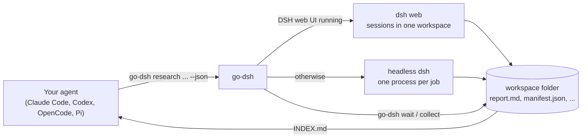

# go-dsh  /ɡoʊ ˈdæʃ/ ("go dash")

**English** | [Deutsch](README.de.md)

[](https://github.com/biegomar/go-dsh/actions/workflows/ci.yml) [](LICENSE)

**Let Claude Code, Codex, OpenCode, Pi or any other agent use [DeepSeek Harness](https://github.com/deepseek-ai/deepseek-harness) (`dsh`) as a parallel worker pool – as a single, fast Rust binary for Windows, macOS and Linux.**

go-dsh is a Rust reimplementation of [dsh-cli](https://github.com/nicremo/dsh-cli) (an npm package, macOS/Linux only). Commands, options, exit codes and JSON output follow the original; on top of that it adds Windows support and needs no Node.js for the tool itself.

> **Unofficial community project.** go-dsh is not affiliated with, endorsed by or sponsored by DeepSeek. "DeepSeek Harness" is a trademark of DeepSeek and is used here only to describe compatibility. The original idea and behavior come from [Fabian Bitzer](https://github.com/nicremo) (MIT license, see [Origin and license](#origin-and-license)).

## Contents

- [What go-dsh does](#what-go-dsh-does)
- [How it works](#how-it-works)
- [Requirements](#requirements)
- [Installation](#installation)
- [Setup (optional)](#setup-optional)
- [Quick start](#quick-start)
- [Commands](#commands)
- [Configuration](#configuration)
- [Operation](#operation)
- [Platform notes (Windows, macOS, Linux)](#platform-notes-windows-macos-linux)
- [Troubleshooting](#troubleshooting)
- [Safety](#safety)
- [Development](#development)
- [Origin and license](#origin-and-license)

## What go-dsh does

`dsh` is an agent harness that works with DeepSeek models – fast and cheap, which makes it a good worker pool. What is missing is a way to drive `dsh` from *another* (main) agent: start sessions, wait for them, read the results, follow up. That is what go-dsh does.

go-dsh is **agent first**: every command is non-interactive, returns at once, prints compact text or `--json`, and uses stable exit codes.

- **Parallel research batches** – `go-dsh research "question 1" "question 2" …` starts one worker per question; each writes `report.md` and `sources.json`, and `go-dsh collect` merges everything into one `INDEX.md`.
- **Material gathering** – `go-dsh materials "brief"` starts one worker per kind (screenshots, scroll videos, news articles, stock footage, stock photos) with a `manifest.json` recording source and licence of every file.
- **Live in the DSH web UI** – when `dsh web` is running, every job becomes a real session in that UI; a batch gets its own workspace and every session a readable title.
- **Headless fallback** – without the UI each job runs in its own `dsh` process with a lean profile (`concert`).
- **Steer like a human would** – `wait`, `status`, `logs -f`, `result`, `files`, `continue` (same session, same folder), `cancel`.
- **Deterministic captures** – `go-dsh capture shot|scroll <url>` takes clean screenshots and smooth 1080p scroll videos with Playwright (cookie banners dismissed, overlays hidden, ad networks blocked, watchdog for hanging pages).
- **No daemon** – state is plain JSON in `~/.dshgo/`; detached runner processes keep jobs alive after the calling shell exits.
- **Agent skill** – a bundled skill (`go-dsh-delegation`) teaches Claude Code, Codex, OpenCode and Pi when and how to delegate work to DeepSeek Harness.

## How it works



1. Your agent calls `go-dsh` (usually through the bundled skill).
2. go-dsh creates a workspace folder and one job per task, hands each job to a detached runner (the same binary, hidden commands `__run-job` / `__run-batch`) and returns the ids at once.
3. The runner either creates a session in the running DSH web UI (through its HTTP API) or starts `dsh --profile concert --json -` and passes the task on stdin.
4. Events are recorded in `~/.dshgo/jobs/<id>/events.jsonl`, progress in `job.json`, the final answer in `result.md`.
5. Your agent waits with `go-dsh wait`, reads `go-dsh result` or `go-dsh collect`, and continues sessions with `go-dsh continue`.

## Requirements

| Component | Purpose | Required |
|---|---|---|
| **DeepSeek Harness (`dsh`)** | does the actual work; log in once or set `DEEPSEEK_API_KEY` | yes |
| Rust ≥ 1.80 | only to build from source | no |
| Python 3 + Playwright | only for `go-dsh capture` | no |
| ffmpeg / ffprobe | scroll videos and media checks | no |
| yt-dlp | downloading stock videos | no |

According to upstream, `dsh` is installed with `npm install -g @deepseek-ai/dsh` (or used from a source checkout). `go-dsh doctor` checks all of this.

Supported platforms: **Windows 10/11**, **macOS**, **Linux** (x86-64 and ARM64 wherever Rust supports them).

## Installation

go-dsh is built from source (the only prerequisite is [Rust](https://rustup.rs)). The installation is **once per machine**, not per project.

```bash
git clone https://github.com/biegomar/go-dsh.git
cd go-dsh
cargo install --path .
```

This installs two programs to `~/.cargo/bin` (Windows: `%USERPROFILE%\.cargo\bin`), which is already on your `PATH` if Rust was installed with `rustup`:

- `go-dsh` – the main command
- `dshgo` – short alias

Alternatively, build a release binary and put it wherever you like:

```bash
cargo build --release
# Result: target/release/go-dsh(.exe) and target/release/dshgo(.exe), about 3 MB each, no runtime dependencies
```

Check the installation:

```bash
go-dsh doctor    # checks dsh, profile, settings, web UI, Playwright, ffmpeg, yt-dlp
```

Whether you also need `go-dsh setup` is explained in [Setup (optional)](#setup-optional).

### Optional: Playwright for `go-dsh capture`

```bash
pip install playwright
python -m playwright install chromium
```

If Python is not found automatically: `go-dsh config set python <path-to-python>`.

## Setup (optional)

go-dsh works right after the installation. `go-dsh setup` only prepares dsh for **headless** jobs and installs the agent skill. Pick what you need:

| You want to… | Run |
|---|---|
| start jobs by hand against the DSH web UI | nothing, no setup needed |
| let an agent (Claude Code, Codex, OpenCode, Pi) call go-dsh | `go-dsh skill install` |
| run headless jobs with search MCP servers or chosen skills | `go-dsh setup` (options below) |
| check the environment at any time | `go-dsh doctor` |

> **Note:** jobs that run in the DSH web UI are executed by the UI's own dsh server and use *its* profile, MCP servers and skills. The profile `concert` created by `setup` only applies to **headless** jobs (no UI running, or `-b headless`).

### What `go-dsh setup` does

1. Creates the dsh profile `concert` in `~/.dsh/profiles/concert/` (from dsh's headless template).
2. Copies search/research MCP servers from another dsh profile into it (default: from `web`; written to `cordis.patch.yml`, readable by you only where the platform supports it, nothing is printed because rows can hold API keys).
3. Links the skills **you name** into `~/.dsh/skills-concert/`, which the profile hands to dsh (default: none).
4. Installs the agent skill `go-dsh-delegation` to `~/.agents/skills/` and links or copies it into the config folders of Claude Code, Codex and Pi, where those are installed.
5. Validates the result with `dsh --profile concert --dump-config`.

It is safe to run again: it only rewrites files it manages (the profile's `cordis.patch.yml`, the links in `skills-concert`, the skill folders).

### Options

| Option | Meaning | Default |
|---|---|---|
| `--mcp research\|all\|none\|id,id` | which MCP servers to copy; `research` matches firecrawl, brave, context7, exa, tavily, perplexity, jina, serper, searx, kagi; a comma list matches row ids or server names | `research` |
| `--from <profile>` | dsh profile to copy the MCP servers from | `web` |
| `--skills a,b,c\|all` | skills to link from `~/.agents/skills`; `all` keeps dsh's own skill defaults | none |
| `--no-skill` | do not install the agent skill | skill is installed |

### Examples

```bash
# 1. Defaults: research MCP servers from the profile "web", no skills, install the agent skill
go-dsh setup

# 2. Only the profile, leave the agent skill alone
go-dsh setup --no-skill

# 3. Copy all MCP servers of "web", none at all, or exactly these (row id or server name)
go-dsh setup --mcp all
go-dsh setup --mcp none
go-dsh setup --mcp firecrawl,brave

# 4. Take the MCP servers from a different dsh profile
go-dsh setup --from work

# 5. Give headless workers two skills (they must exist in ~/.agents/skills)
go-dsh setup --skills playwright,firecrawl

# 6. Keep dsh's own skill defaults
go-dsh setup --skills all

# 7. Combined
go-dsh setup --mcp context7,exa --skills playwright --no-skill

# Only the agent skill, without touching dsh (copy instead of links)
go-dsh skill install
go-dsh skill install --agents claude,codex --copy
```

To see which names you can use (PowerShell on Windows; `ls` and `grep serverName` do the same elsewhere):

```powershell
dir $HOME\.agents\skills                                         # skills available for --skills
Select-String serverName $HOME\.dsh\profiles\web\cordis.patch.yml   # MCP servers of the profile "web"
```

Example output (your names and counts will differ):

```
dsh profile "concert" ready: C:\Users\you\.dsh\profiles\concert
  MCP servers: firecrawl, brave
  Skills:      2 linked in C:\Users\you\.dsh\skills-concert
Agent skill installed: C:\Users\you\.agents\skills\go-dsh-delegation
  claude   linked
  codex    skipped (not installed)
  pi       skipped (not installed)
DSH web UI found at http://127.0.0.1:3080: jobs will run there.
```

The lines starting with `Note:` are hints, not errors, for example "no skills selected" or "no matching MCP servers in the "web" profile; workers use the built-in web_search and web_fetch". On Windows without developer mode the agent skill is `copied` instead of `linked`.

Afterwards `go-dsh doctor` shows a `✓ profile` line with the folder of `concert`, and headless jobs start with `dsh --profile concert`.

### Undo

Delete what `setup` created; `go-dsh doctor` then falls back to dsh's built-in `headless` profile.

```powershell
Remove-Item -Recurse $HOME\.dsh\profiles\concert, $HOME\.dsh\skills-concert
Remove-Item -Recurse $HOME\.agents\skills\go-dsh-delegation
Remove-Item -Recurse $HOME\.claude\skills\go-dsh-delegation, $HOME\.codex\skills\go-dsh-delegation   # if present
```

```bash
rm -rf ~/.dsh/profiles/concert ~/.dsh/skills-concert ~/.agents/skills/go-dsh-delegation
rm -rf ~/.claude/skills/go-dsh-delegation ~/.codex/skills/go-dsh-delegation                         # if present
```

## Quick start

Run three research questions in parallel and collect the results:

```bash
go-dsh ui start                       # optional: start the DSH web UI to watch the jobs live
go-dsh research "Which async runtimes exist for Rust and when does each fit?" \
                "How do SQLite crates for Rust compare?" \
                "State of the WebAssembly Component Model" \
                --depth standard -C ~/dsh-workspaces/rust-research
go-dsh wait last-batch --timeout 9m   # exit code 4: still running, just wait again
go-dsh collect last-batch             # writes ~/dsh-workspaces/rust-research/INDEX.md
```

Single tasks, material, follow-ups and captures:

```bash
go-dsh run -w "List the most important changes of the Rust 2024 edition in five bullet points"
go-dsh materials "Balcony solar panels in Germany, factual tone" --kinds screenshots,articles
go-dsh continue last "Add a table of pros and cons"
go-dsh capture shot https://www.rust-lang.org -o rust.png --full
```

On Windows (PowerShell), with a task list from a file (one task per line, `#` starts a comment):

```powershell
@"
# Tasks for today
Summarize the changes of the last three Rust releases
List common pitfalls when cross-compiling on Windows
"@ | Set-Content tasks.txt -Encoding utf8

go-dsh batch -f tasks.txt -C D:\dsh-workspaces\rust-tips -p 2
go-dsh wait last-batch --timeout 9m
go-dsh collect last-batch
```

### Using it from your own agent

After `go-dsh setup` or `go-dsh skill install` your agents know the skill. Just ask in plain language:

> Have DeepSeek Harness check in parallel which of the five libraries in `Cargo.toml` are outdated, and summarize the result for me.

The skill tells the agent to start a batch, wait in steps that fit its shell timeout, read `INDEX.md`, spot-check the results and follow up where needed. `go-dsh guide` prints the same manual for agents without skill support.

## Commands

| Command | What it does |
|---|---|
| `go-dsh run <task>` | one job in the background (`-w` waits and prints the answer) |
| `go-dsh batch -f tasks.txt` | many jobs in parallel, one folder each (`.txt`, blocks split by `---`, `.json`, `.jsonl`) |
| `go-dsh research <question>...` | parallel research workers (`--depth quick\|standard\|deep`, `--focus`) |
| `go-dsh materials <brief>` | one worker per kind (`--kinds`, `--count`, `--url`) |
| `go-dsh status [ref]` | overview, or details of a job or batch |
| `go-dsh ls [--batches]` | list jobs or batches (`-n`, `--running`, `--batch`) |
| `go-dsh wait <ref>...` | block until done (`--timeout`, `--any`) |
| `go-dsh result <ref>` | final answer(s) (`--files`) |
| `go-dsh logs <job>` | timeline of tool calls (`-f`, `--full`, `--raw`, `--stderr`) |
| `go-dsh files <ref>` | files the job created (`--all`) |
| `go-dsh continue <job\|batch> <text>` | continue the same session; for a batch, every finished job gets the follow-up as a new batch (`--only-failed`, `-p`) |
| `go-dsh cancel <ref>` | stop a job or a whole batch |
| `go-dsh collect <batch>` | write `INDEX.md`, merge `manifest.json` and `sources.json` (`-o`) |
| `go-dsh capture shot\|scroll <url>` | screenshots and scroll videos |
| `go-dsh ws init <dir>` | create a workspace with conventions in `AGENTS.md` |
| `go-dsh ui [start\|stop\|login]` | open, start (`--open` also opens the browser), stop or log in to the DSH web UI |
| `go-dsh skill install` | install or refresh the agent skill |
| `go-dsh setup` / `go-dsh doctor` | one-time setup / environment check |
| `go-dsh config [set\|unset]` | persistent settings |
| `go-dsh guide` | the manual for agents |

**References** (`<ref>`): job id, batch id, unique prefix, name, `last` (newest job), `last-batch` (newest batch).

**Common options:** `-C <dir>` workspace folder · `-m flash|pro|v4-flash|vision` (or a full model id) · `--effort off|low|high|max` · `-t <duration>` time limit (`90s`, `20m`, `1h`; default 30m) · `-p <n>` parallelism · `-b auto|web|headless` backend · `-w` wait · `--max-wait <duration>`. Every command has `--help`.

### JSON and exit codes

Every command accepts `--json` and prints exactly one object: `{ "ok": true, … }` or `{ "ok": false, "error", "code", "hint" }`.

| Exit code | Meaning |
|---|---|
| 0 | success |
| 1 | a job failed, timed out or was cancelled |
| 2 | usage error |
| 3 | job or batch not found |
| 4 | wait timeout reached, or the job is not finished yet |
| 5 | environment problem (dsh missing, UI unreachable, Playwright missing) |

## Configuration

`go-dsh config set <key> <value>` stores settings in `~/.dshgo/config.json` (Windows: `%USERPROFILE%\.dshgo\config.json`). **Environment variables win over the file.** `go-dsh config` shows the effective values and where they come from.

| Key | Environment | Meaning |
|---|---|---|
| `dshRepo` | `DSHGO_DSH_REPO` | use a dsh source checkout (wins over `dshBin`) |
| `dshBin` | `DSHGO_DSH_BIN` | path to the `dsh` executable (default: `dsh` on `PATH`; on Windows `dsh.cmd` is found too) |
| `webUrl` | `DSHGO_WEB_URL` | origin of the DSH web UI (default `http://127.0.0.1:3080`) |
| `backend` | `DSHGO_BACKEND` | `auto`, `web` or `headless` |
| `workspaces` | `DSHGO_WORKSPACES` | root for new workspaces (default `~/dsh-workspaces`) |
| `python` | `DSHGO_PYTHON` | Python with Playwright for captures |

Other variables:

| Variable | Meaning |
|---|---|
| `DSHGO_HOME` | state folder (default `~/.dshgo`) |
| `DSH_HOME` | dsh home (default `~/.dsh`) |
| `DSH_AGENTS_HOME` | root of the shared skills (default `~/.agents`) |
| `DSHGO_WEB_TOKEN_URL` / `DSHGO_WEB_TOKEN_FILE` | token URL of the web UI |
| `DSHGO_WEB_POLL_MS` | polling interval of the web backend in ms (default 2000) |
| `DSHGO_DSH_CMD` | replacement executable for `dsh` (tests) |
| `CLAUDE_CONFIG_DIR`, `CODEX_HOME` | alternative config folders for the skill installation |

`~` is expanded in settings and path arguments (on Windows `~\` as well).

### Files

```
~/.dshgo/
  config.json            settings
  web-auth.json          cookie for the DSH web UI (mode 0600 on Linux/macOS)
  web-token-url          last remembered token URL
  capture.py             embedded capture script (written on demand)
  jobs/<id>/             job.json, task.md, events.jsonl, stderr.log, result.md
  batches/<id>/          batch.json
  logs/                  runner logs
<workspace>/
  AGENTS.md, .dshgo-workspace
  <nn-job>/              one folder per batch job
  INDEX.md               after go-dsh collect
```

State folder, variables (`DSHGO_*`) and workspace marker (`.dshgo-workspace`) are deliberately named independently of dsh-cli (`~/.dsho`, `DSHO_*`). Both tools can be installed side by side but do not share state.

## Operation

### The web UI backend

When the DSH web UI is reachable, go-dsh talks to its HTTP API (`POST /api/<namespace>/<method>`): it registers the workspace folder, creates a session in it, names it, optionally selects a model, sends the task, and polls the session log until the turn that answers the task has ended. The session log is translated into the same event format the headless mode produces, so `logs`, `status` and `result` work the same everywhere.

- `go-dsh ui start` starts `dsh web` in the background, captures the token URL it prints and logs in. It does not open a browser; add `--open` for that (`go-dsh ui start --open`, also when the UI is already running), or run `go-dsh ui` at any time. Both open the remembered token URL, so the browser is logged in too; `go-dsh ui --print` only prints the plain address.
- `go-dsh ui stop` ends the local DSH web UI (the `node` process behind port 3080, with its child processes). It only touches a port that really answers as the web UI and refuses while web jobs are still running (`--force` stops anyway; those jobs are lost). Use `go-dsh wait`/`go-dsh cancel` first, or `go-dsh ui stop --force`. A UI you started by hand in a terminal can be stopped the same way.
- If you start `dsh web` yourself, pass the URL it prints once: `go-dsh ui login "http://127.0.0.1:3080/?token=..."`. The cookie is stored in `~/.dshgo/web-auth.json`, stays valid for 30 days and survives server restarts.
- `-b web` turns a missing UI into an error instead of silently falling back to headless. `go-dsh ui <ref>` names the workspace and session titles to look for in the UI.

### The headless backend and `go-dsh setup`

Headless jobs run `dsh --profile concert --json -` in the job folder. `go-dsh setup` builds that profile from dsh's shipped headless template plus:

- **MCP servers** copied from another profile (default `web`): `--mcp research` (firecrawl, Brave, context7, Exa, Tavily, Perplexity, Jina and similar; the default), `all`, `none` or a comma list of ids. Copied rows can contain API keys, so the profile file is written readable by the current user only (where the platform supports it) and nothing is printed. `!!js` expressions are preserved unchanged when copying.
- **skills you name** with `--skills a,b,c`: they are linked from `~/.agents/skills` into `~/.dsh/skills-concert`, which the profile `concert` hands to dsh. By default **no skills** are linked, which keeps the worker prompt as small as possible. A name that does not exist in `~/.agents/skills` is reported and skipped; links from an earlier run that are no longer named are removed. `--skills all` keeps dsh's own defaults instead.
- `.dshgo-workspace` as an extra project root marker, so workers in batch subfolders still load the workspace `AGENTS.md`.

### Jobs, batches and cancellation

- Starting is asynchronous: `run`, `batch`, `research` and `materials` return ids at once (with `-w` they block until the result).
- `wait --timeout 9m` stays under the 10 minute limit of a single shell call in most agents; exit code 4 means "still running, wait again".
- `continue` also takes a batch: every job that is no longer running and has a session gets the same follow-up and runs on in its own session and folder. The continuations form a **new batch** (jobs point to their originals), so `wait`, `status` and `collect` work as usual. `--only-failed` skips jobs that are already `done`; jobs that are still running are skipped and listed.
- A job whose runner process has disappeared (reboot, kill) is reported as `lost` – just start it again.
- `cancel` writes a cancel marker and stops the `dsh` process; cancelling a batch covers all unfinished jobs. With the web backend, `session/cancel` is sent to the UI.
- `-p` limits the parallelism of a batch (default: all, at most 10); the first wave is slightly staggered (400 ms) so parallel `dsh` starts do not race on caches.

### Captures

`go-dsh capture shot|scroll <url> -o <file>` runs the embedded Python/Playwright script (Playwright's Chromium, never the installed Chrome). Defaults: dismiss cookie banners, hide overlays, block ad networks, WebGL off. More switches: `--no-dismiss`, `--keep-overlays`, `--allow-ads`, `--hide <css>`, `--dark`, `--scale 2` (shot), `--max-time <s>` (hard time limit). Scroll videos need ffmpeg. The output is one JSON object.

## Platform notes (Windows, macOS, Linux)

go-dsh behaves the same on all platforms; the following points are implemented specifically for Windows:

- **Detached runners**: on Windows go-dsh starts runners without a console window in their own process group and does not pass its own standard handles on to them. A calling agent that captures stdout therefore returns at once instead of waiting for the end of the job.
- **Cancellation**: Windows has no "gentle" SIGTERM for console processes. `cancel` and timeouts end the `dsh` process tree with `taskkill /T /F`; on macOS/Linux the process group gets SIGTERM first and SIGKILL after 5 s.
- **`dsh.cmd`**: programs installed with npm are `.cmd` files on Windows. go-dsh finds them through `PATH`/`PATHEXT`.
- **Linking skills**: symlinks need developer mode or administrator rights on Windows. If they are not allowed, go-dsh copies the skill folder instead (output: `copied` instead of `linked`; `go-dsh skill install` refreshes copies later).
- **File permissions**: mode 0600 for cookie/token/profile applies only on Linux/macOS; on Windows the user profile protects the files.
- **Python**: `python`, `python3` and `py` are tried as candidates for captures (the Microsoft Store placeholder is skipped because it cannot import `playwright`).
- **Web UI over HTTP only**: go-dsh is built without a TLS library; the local DSH web UI runs on `http://127.0.0.1`. An `https://` `webUrl` is not supported.

## Troubleshooting

| Symptom | Fix |
|---|---|
| `dsh not found` | `npm install -g @deepseek-ai/dsh`, or `go-dsh config set dshBin <path>` / `dshRepo <path>` |
| jobs do not show up in the UI | `go-dsh doctor`; `go-dsh ui start` or `go-dsh ui login <url>`; start jobs with `-b web` |
| a job is `lost` | its runner process died (reboot, kill); start it again |
| a headless job is `failed` with `MISSING_CREDENTIAL` (`no API key for provider route "deepseek-official"`) | headless jobs need an API key: export `DEEPSEEK_API_KEY` or store it on the Models page of the DSH web UI. Jobs in the web UI do not need it; `go-dsh doctor` shows the `api-key` line |
| headless workers stall | set dsh's permission preset to full access for unattended runs (`go-dsh doctor` shows it) |
| `go-dsh capture` fails | `pip install playwright && python -m playwright install chromium`; scroll videos need ffmpeg |
| a page hangs during capture | the watchdog stops it after `--max-time` (default 90 s for shots) |
| `Cannot authenticate against the DSH web UI` | `go-dsh ui login "<URL with ?token=…>"` using the output of `dsh web` |
| more detail on a failure | `go-dsh logs <job> --stderr` or `go-dsh status <job>` |

## Safety

`dsh` workers can run shell commands; many setups run dsh with full access and no sandbox. Keep tasks scoped to the workspace and never delegate deletes, deploys, `git push` or anything that touches secrets. Material found by workers is not automatically yours to publish: check licence and source in `manifest.json`. The cookie/token files in `~/.dshgo` are confidential.

## Development

```bash
cargo build                 # debug build
cargo test                  # unit tests + integration tests
cargo clippy --all-targets
cargo fmt
```

The integration tests start the real `go-dsh` binary against a fake `dsh` (`examples/fake_dsh.rs`) and a small fake web UI (`tests/web.rs`); they never touch your real setup. The fake `dsh` understands the markers `SLEEP <s>`, `WRITE <file>` and `FAIL` in the task text.

Layout (`src/`):

| File | Purpose |
|---|---|
| `cli.rs` | command line (clap), commands, text/JSON output |
| `runner.rs` / `supervisor.rs` | running a job or a batch, cancellation, detached processes |
| `store.rs` | jobs and batches as JSON, reference resolution, `lost` detection |
| `dsh.rs` | locating and launching `dsh` (binary, source checkout, replacement executable) |
| `web.rs` | DSH web UI client (auth, sessions, event translation, `ui start`) |
| `events.rs` | event stream → progress and timeline |
| `collect.rs` | `INDEX.md`, `manifest.json`, `sources.json` |
| `templates.rs` | prompt templates for workers and `AGENTS.md` |
| `profile.rs` | `setup` (profile `concert`) and `doctor` |
| `skills.rs` | installing the agent skill |
| `config.rs`, `paths.rs`, `util.rs` | settings, paths, helpers and platform-specific process functions |
| `assets/` | embedded: `guide.md`, skill, `capture.py` |

## Origin and license

go-dsh is a reimplementation of the behavior of [nicremo/dsh-cli](https://github.com/nicremo/dsh-cli) (commit `46d5ff8`, version 0.1.0, as of 2026-10-09), created by analysing its source with REA (Reverse Engineer Anything) and checking against its README. Embedded texts (agent skill, manual) and the capture script (`assets/capture.py`) come from the original and were adapted in command and folder names and in the examples.

Not carried over or different from the original: no npm/Node runtime requirement for the tool itself, Windows support, no TLS support for the web UI connection, processes run as Rust threads instead of a Node event loop.

[MIT](LICENSE) – Copyright (c) 2026 Fabian Bitzer (original dsh-cli), Copyright (c) 2026 Marc Biegota (go-dsh). The Rust port is under the same license.
